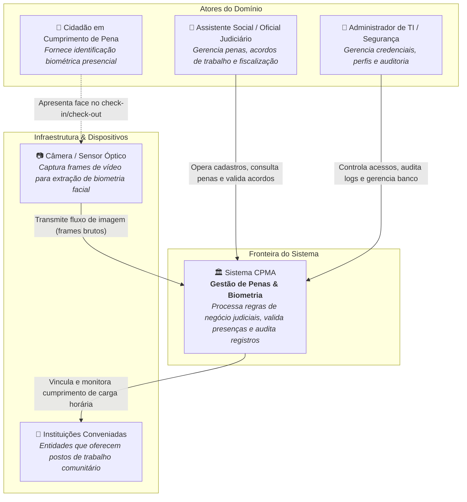
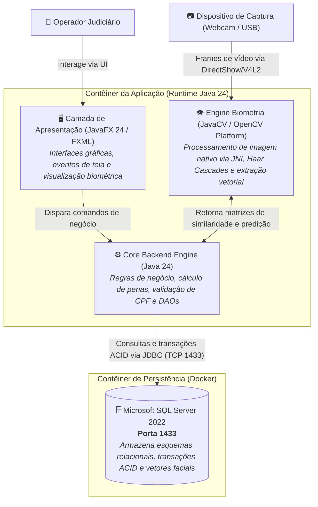
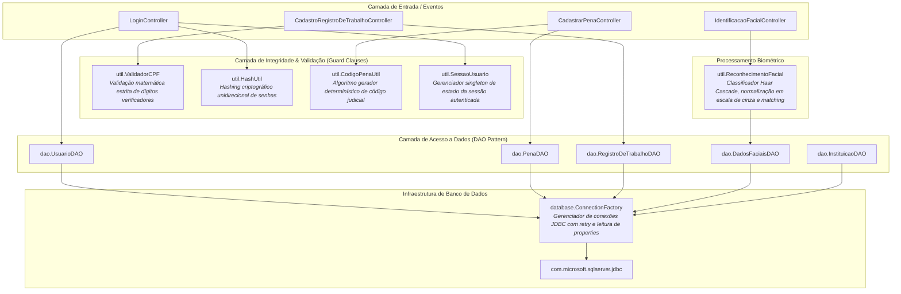
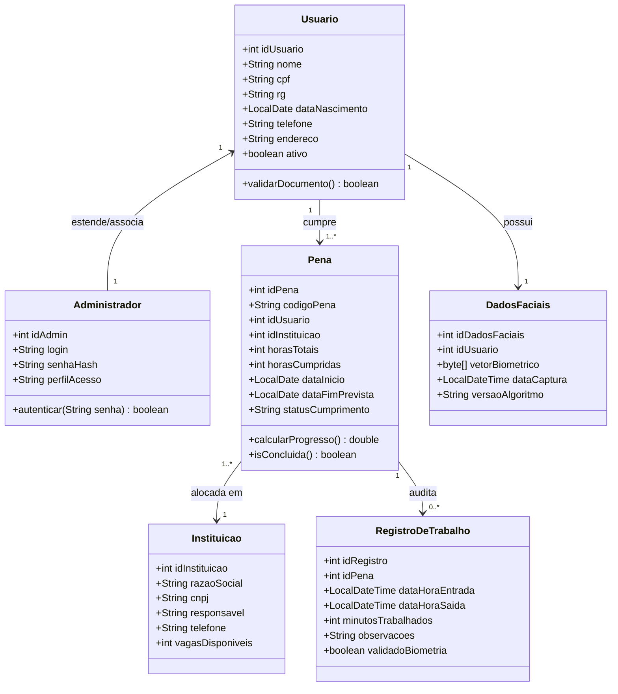
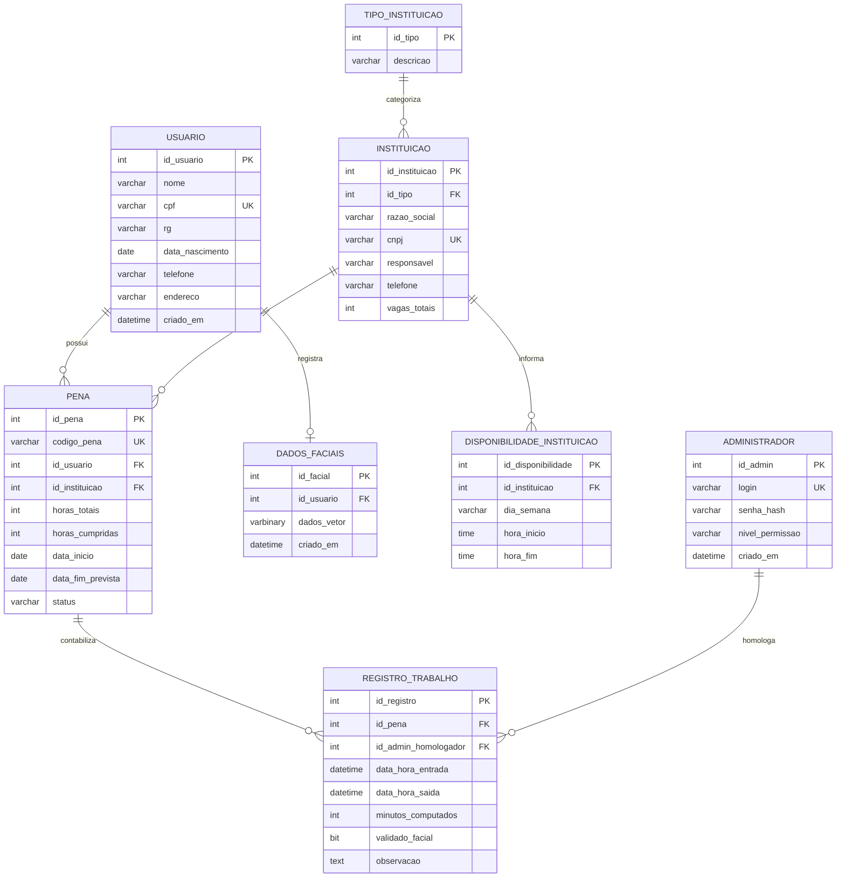

# CPMA - Sistema de Gestão de Penas Alternativas & Biometria Judicial

[](https://openjdk.org/)
[](https://www.microsoft.com/sql-server)
[](https://github.com/bytedeco/javacv)
[](#-arquitetura-de-software--modelo-c4)
[](docker-compose.yml)

Sistema corporativo de engenharia de backend para **gestão transacional, governança judicial e fiscalização biométrica presencial** de cidadãos em cumprimento de penas e medidas alternativas. Desenvolvido para garantir rastreabilidade estrita de acordos de trabalho comunitário, auditoria de presença via reconhecimento facial e integridade de dados relacionais em conformidade com as exigências do Poder Judiciário.

---

## 🏛️ Arquitetura de Software — Modelo C4

Para assegurar clareza arquitetural em todos os níveis de abstração técnica, a solução está documentada seguindo a taxonomia completa do **Modelo C4** (Simon Brown), do contexto sistêmico à granularidade de código e modelagem de dados.

```
Nível 1: Contexto Sistêmico  ────────► Atores, Judiciário e Dispositivos Externos
Nível 2: Contêineres         ────────► Runtime Java 24, SQL Server 2022 em Docker, JavaCV
Nível 3: Componentes Backend ────────► Controllers, Engines Biométricas, Guard Clauses e DAOs
Nível 4: Código & Schemas    ────────► Diagrama de Classes e Entidade-Relacionamento (ERD)
```

---

### Nível 1: Diagrama de Contexto (System Context)

O diagrama de contexto estabelece a fronteira do sistema CPMA, destacando os atores humanos (operadores do judiciário e apenados) e os dispositivos físicos periféricos que interagem com o ecossistema.



---

### Nível 2: Diagrama de Contêineres (Containers)

Evidencia a divisão em contêineres lógicos e de infraestrutura: a aplicação desktop em Java 24, a camada nativa de visão computacional (JavaCV/OpenCV) e o banco de dados relacional Microsoft SQL Server 2022 orquestrado via Docker Compose.



---

### Nível 3: Diagrama de Componentes (Backend Components)

Demonstra a arquitetura interna do contêiner da aplicação, evidenciando o desacoplamento rigoroso entre **Controladores**, **Serviços de Validação/Guards**, a **Engine Biométrica** e a camada de persistência com o padrão **DAO**.



---

### Nível 4: Diagrama de Código & Schemas de Dados (Code & Data Model)

O nível mais profundo do C4 detalha o modelo de domínio orientado a objetos e o esquema físico relacional do banco de dados (DDL/ERD).

#### 4.1 Diagrama de Classes de Domínio (Class Diagram)



#### 4.2 Modelo Entidade-Relacionamento (ERD - SQL Server)

Modelagem física implementada no script [penas-alternativas.sql](script/penas-alternativas.sql), garantindo chaves primárias, estrangeiras e integridade referencial:



---

## 🛠️ Stack Tecnológica & Racional de Engenharia

| Componente | Tecnologia | Racional Arquitetural |
|---|---|---|
| **Linguagem Core** | **Java 24 (LTS ecosystem)** | Tipagem forte estrita, robustez transacional e gerenciamento determinístico de memória. |
| **Banco de Dados** | **Microsoft SQL Server 2022** | Padrão empresarial para integridade ACID, suporte robusto a transações concorrentes e tipos binários (`varbinary`) para dados biométricos. |
| **Containerização** | **Docker & Docker Compose** | Reprodutibilidade de ambiente local idêntico à produção para o banco de dados relacional. |
| **Visão Computacional** | **JavaCV / OpenCV** | Extração de características faciais de alta velocidade acoplada via pontes nativas C++ JNI. |
| **Padrão de Dados** | **DAO (Data Access Object)** | Isolamento total entre a lógica de negócios e as instruções SQL nativas via JDBC. |

---

## 🚀 Execução Local da Infraestrutura e Aplicação

### 1. Inicialização do Banco de Dados Relacional (Docker)

Suba o container do SQL Server e provisione as tabelas e constraints:

```bash
# 1. Iniciar o container SQL Server 2022
docker-compose up -d

# 2. Copiar o script DDL com o esquema de dados para o container
docker cp ./script/penas-alternativas.sql sqlserver_dev:/tmp/

# 3. Executar o provisionamento com sqlcmd
docker exec -it sqlserver_dev /opt/mssql-tools18/bin/sqlcmd \
  -S localhost -U SA -P 'MinhaSenha_forte123' \
  -i /tmp/penas-alternativas.sql -C
```

### 2. Configuração de Credenciais de Banco

```bash
# Copiar o template de propriedades
cp src/main/resources/db.properties.example src/main/resources/db.properties
```

### 3. Build & Execução do Core

```bash
# Compilar todas as classes e validar dependências via Maven
mvn clean compile

# Executar a aplicação
mvn javafx:run
```

---

## 🔒 Segurança, Confiabilidade e Governança de Dados

- **Proteção Criptográfica:** Nenhuma senha trafega ou é persistida em texto plano; todas passam por digest criptográfico via `HashUtil`.
- **Validação na Borda (Guard Clauses):** Todo CPF inserido no sistema é submetido à validação algorítmica de dígitos de controle antes de qualquer chamada ao banco de dados.
- **Rastreabilidade Judicial:** Cada registro de presença possui vínculo explícito com o identificador de homologação e indicação booleana de validação biométrica (`validado_facial`).

---

<div align="center">
  <sub>Documentação arquitetural de backend elaborada com padrões de Engenharia de Software e Modelo C4.</sub>
</div>
